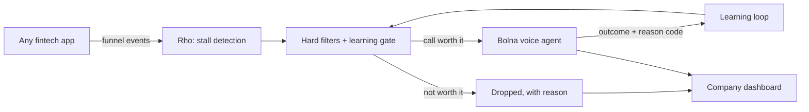

# Rho-for-Bolna
# Rho

### To the Bolna team and judges: welcome, and thank you for reading.
You have a lot of submissions to get through, so here is the short version first, and the detail below if you want it.

**Rho decides which calls are worth making, then makes them with Bolna, the voice of India.**
Fintech apps lose most users during signup. Calling every stalled user is too expensive and annoying. Rho calls only the users a call will actually change, within minutes of them stalling, and learns from every conversation.

**Try it in 90 seconds**
1. Open the app: https://astro-naut.github.io/Rho-for-Bolna/ (a stand-in for any investing or saving app)
2. Dashboard: https://rho-for-bolna.vercel.app/
3. Demo video (3 min): [video link]
4. Code: You are here already!

---

## The problem
Users start onboarding, then stall at KYC, bank linking or the first deposit, and never return. The usual fixes don't work well:
- **Message blasts** reach everyone and move few people.
- **Calling everyone** is costly, most calls go unanswered, repeat calls drive opt-outs, and DND and consent rules apply.
- **A call a day later** reaches someone whose intent has gone.

The hard question isn't *how* to call. It's *whether this call is worth making, for this user, right now.*

## What we built
1. **Detect the stall.** App events arrive in real time, and a stall opens when a user idles past a stage's threshold.
2. **Decide.** Hard filters run first (consent, DND, calling hours, per-user cap, budget). Then a learning gate (a contextual bandit) scores expected *uplift* per rupee, not raw conversion chance, so we skip people who would return anyway or never will. A 10% random holdout lets us measure real lift.
3. **Call with Bolna.** The voice agent phones the user, in Hinglish, Hindi or English, with the exact step they stalled on.
4. **Learn.** Each call returns a reason code (trust, fees, KYC confusion, no time, technical error) that updates the next decision.
5. **Show the company.** A dashboard shows calls made vs dropped (and why), cost per call, projected spend, and a threshold the company controls.

## Why voice is the product, not a feature
The call is the intervention. Everything around it exists to make it timely and worth the cost. Voice reaches users in their own language at the moment of friction, and every call becomes structured product insight, not just a conversion attempt.

## How we use Bolna
- `POST /call` with `user_data` so each call carries the user's stage, idle time and language
- Post-call extraction for reason codes and outcomes
- Execution results (`conversation_duration`, `termination_reason`, `total_cost`) feeding the model and the cost view
- A custom function so the agent can act mid-call: [resend link / check status, edit to what you built]

## Architecture

## What works today
- [x] Event ingest and stall detection
- [x] Hard filters with a logged reason for every dropped call
- [ ] Scored gate with a threshold the company can set [edit]
- [ ] Live Bolna call from a real app event [edit]
- [ ] Learning loop from call outcomes [edit]
- [ ] Dashboard: made vs dropped, cost, what-if slider [edit]

Anything unchecked is on our next-steps list, and we'd rather tell you than hide it.

## Honest notes
- **Data:** we have no real customer data, so the demo runs on a generated funnel and on calls to consenting teammates only. We make no claims about real-world lift yet. We'll measure it with the holdout.
- **Scale:** we don't scale the calls, we scale the decision. Every stalled user is scored cheaply, and only a small, budget-ranked slice gets a call.
- **Defensibility:** one customer makes this a feature. Neutrality across analytics and voice vendors, plus outcome data that compounds across customers, makes it a company.
- **Guardrails:** consent required, DND respected, calling window, a cap per user, instant opt-out, no financial advice, and the agent never denies being an AI when asked. [confirm each is implemented]

## Team
Built by Amrita and Pranav [add surnames, links] for the Bolna Buildathon.

Thank you for building the voice layer that made this possible. We'd love your feedback: [contact].
